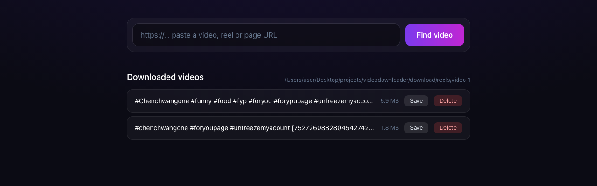

<div align="center">

# Any Video Downloader

**Paste a link. Get the video in Full HD.**
A fast, self-hosted video downloader for TikTok, Instagram Reels, YouTube, Facebook, X and 1000+ other sites, powered by FastAPI and yt-dlp.


</div>



## Features

- **Single video download** from any supported link: videos, reels, shorts, posts
- **Profile / playlist / channel mode**: list every video, pick the ones you want, download them into one folder
- **SSFlix movies & series** (`/ssflix.html`): paste an SSFlix link, then choose one episode, one season, or the full series. Episodes have `S02E01` filenames and are grouped into season folders.
- **Full HD by default** with automatic best-quality merge (ffmpeg bundled via `imageio-ffmpeg`)
- **Live progress** for every download, including a separate row for each selected video with waiting, downloading, merging, finished or failed status, percentage, speed and remaining time
- **Browser login reuse** (Chrome, Safari, Firefox, Edge, Brave) for profiles that need a login
- **Built-in file manager**: save or delete downloaded videos from the UI
- **Reels Maker** (`/reels.html`): cut a long video (link or already-downloaded file) into 10–15 reels of 1–5 min each, vertical 9:16 or original, saved to `download/<video name>/reels/`
- **Discover** (`/discover.html`): type a topic (e.g. `chinese funny video` or `中国搞笑视频`) and get the top 3 most viewed + liked videos from YouTube and Bilibili, then download one or all 3 with a click into `download/discover/<topic>/`. Every download (from any page) is remembered in `history.db`, so a video is never suggested or downloaded again, even after you delete the file. Save your niches as one-click chips.
- **Facebook titles & hashtags**: every Discover result gets 3 hook-style Facebook Reel titles and 15 hashtags (topic + the video's own tags + broad reach tags) with copy buttons; the caption is also saved as `<video>.facebook.txt` next to the download. Works offline out of the box; for Claude-written titles (translates Chinese titles, fits each video exactly) run `./venv/bin/pip install anthropic` and put `ANTHROPIC_API_KEY=...` in a `.env` file.
- **REST API** with interactive docs at `/docs`
- Clean dark UI built with Tailwind CSS, no build step


## Quick start

```bash
git clone https://github.com/hilalahmad0101/any-videodownloader.git
cd any-videodownloader
./run.sh
```

Then open <http://127.0.0.1:8765>.

`run.sh` creates a virtual environment and installs dependencies on first run. Requires **Python 3.10+**.

Manual setup:

```bash
python3 -m venv venv
./venv/bin/pip install -r requirements.txt
./venv/bin/python main.py
```

Downloads are saved to `download/reels/video 1/`.

## SSFlix movies and series

Open <http://127.0.0.1:8765/ssflix.html> and paste a movie, series, season, or episode URL. For example:

```text
https://ssflix.pro/watch/serie/into-the-badlands-47450/season-2/episode-1
```

Click **Find movie / episodes**. An episode link initially selects that episode. Choose **Entire series**, **One season**, or **One episode**, then click **Download selected**. You can also uncheck episodes within a season or series. Each selected video gets its own progress row, and downloads run one at a time. The job link in the address bar restores its progress after a refresh while the app is running. Files are saved under `download/reels/<folder>/Season 02/` (movies go directly in the chosen folder). Failed episodes are listed and the remaining downloads continue.

The **Server** selector defaults to **Server 5**. Choosing a server uses only that server; **Automatic** tries alternatives. Server 5 exposes some dubs as separate named streams (for example, `Orion · Hindi`), which are recognised even if their manifests have no language tag.

The **Audio language** selector defaults to **Hindi dub**. Hindi, Urdu and English selections require a matching language tag or an explicitly labelled dubbed stream. The downloader checks alternate SSFlix servers and reports a failure if it cannot confirm the chosen language; it does not silently substitute English. **Source default** keeps the source's normal audio choice. A Hindi-dubbed file is saved with `[Hindi]` in its filename, so an existing English file is not reused or overwritten. A language selector cannot translate or create a dub.

SSFlix uses a dynamic embedded player. `./run.sh` installs Playwright and Chromium on existing installations as well. For manual setup, also run:

```bash
./venv/bin/python -m playwright install chromium
```

The catalogue uses the site's public TMDB configuration. Media discovery opens the site's own player and tries up to six servers. Resolution depends on what the source offers; selecting 1080p cannot increase a 720p source. Unavailable players and episodes are reported as failures. No full episodes are downloaded during tests.

Validation: `./venv/bin/python -m unittest discover -s tests -v`.

## API

| Method | Endpoint | Description |
| --- | --- | --- |
| POST | `/api/info` | Fetch video metadata for a URL |
| POST | `/api/download` | Start a single download |
| POST | `/api/playlist/info` | List videos in a profile / playlist, or an SSFlix movie / series |
| POST | `/api/playlist/download` | Download selected videos into a folder |
| GET | `/api/progress/{job_id}` | Poll download progress |
| GET | `/api/downloads` | List downloaded files |
| GET | `/api/files/{name}` | Download a saved file |
| DELETE | `/api/files/{name}` | Delete a saved file |
| POST | `/api/discover/search` | Top N new videos for a topic (by views + likes) |
| POST | `/api/discover/download` | Download chosen Discover videos |
| GET | `/api/discover/history` | Everything ever downloaded |
| DELETE | `/api/discover/history/{key}` | Forget a video so it can be suggested again |
| POST | `/api/captions` | Facebook titles + hashtags for a video |

Interactive docs: <http://127.0.0.1:8765/docs>

## Tech stack

FastAPI · Uvicorn · yt-dlp · ffmpeg (imageio-ffmpeg) · Tailwind CSS

## Tips

- Keep yt-dlp fresh, since sites change often: `./venv/bin/pip install -U yt-dlp`
- For private or login-gated profiles (TikTok, Instagram), choose your browser in the "Use my browser's login" dropdown.

## Disclaimer

For personal use only. Respect copyright and the terms of service of the sites you download from. Only download content you own or have permission to save.

## License

[MIT](LICENSE)
