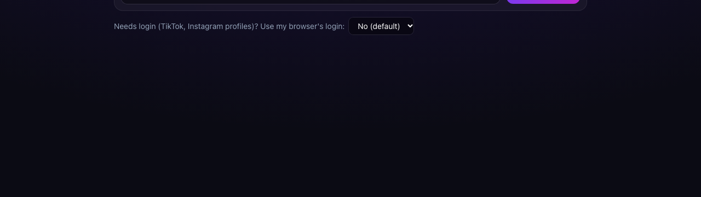

<div align="center">

# Any Video Downloader

**Paste a link. Get the video in Full HD.**
A fast, self-hosted video downloader for TikTok, Instagram Reels, YouTube, Facebook, X and 1000+ other sites, powered by FastAPI and yt-dlp.


</div>


## Features

- **Single video download** from any supported link: videos, reels, shorts, posts
- **Profile / playlist / channel mode**: list every video, pick the ones you want, download them into one folder
- **Full HD by default** with automatic best-quality merge (ffmpeg bundled via `imageio-ffmpeg`)
- **Live progress** for every download
- **Browser login reuse** (Chrome, Safari, Firefox, Edge, Brave) for profiles that need a login
- **Built-in file manager**: save or delete downloaded videos from the UI
- **REST API** with interactive docs at `/docs`
- Clean dark UI built with Tailwind CSS, no build step



## Quick start

```bash
git clone https://github.com/hilalahmad0101/any-videodownloader.git
cd any-videodownloader
./run.sh
```

Then open <http://127.0.0.1:8765>.

`run.sh` creates a virtual environment and installs dependencies on first run. Requires **Python 3.10+**.

Manual setup:

```bash
python3 -m venv venv
./venv/bin/pip install -r requirements.txt
./venv/bin/python main.py
```

Downloads are saved to `download/reels/video 1/`.

## API

| Method | Endpoint | Description |
| --- | --- | --- |
| POST | `/api/info` | Fetch video metadata for a URL |
| POST | `/api/download` | Start a single download |
| POST | `/api/playlist/info` | List videos in a profile / playlist |
| POST | `/api/playlist/download` | Download selected videos into a folder |
| GET | `/api/progress/{job_id}` | Poll download progress |
| GET | `/api/downloads` | List downloaded files |
| GET | `/api/files/{name}` | Download a saved file |
| DELETE | `/api/files/{name}` | Delete a saved file |

Interactive docs: <http://127.0.0.1:8765/docs>

## Tech stack

FastAPI · Uvicorn · yt-dlp · ffmpeg (imageio-ffmpeg) · Tailwind CSS

## Tips

- Keep yt-dlp fresh, since sites change often: `./venv/bin/pip install -U yt-dlp`
- For private or login-gated profiles (TikTok, Instagram), choose your browser in the "Use my browser's login" dropdown.

## Disclaimer

For personal use only. Respect copyright and the terms of service of the sites you download from. Only download content you own or have permission to save.

## License

[MIT](LICENSE)
